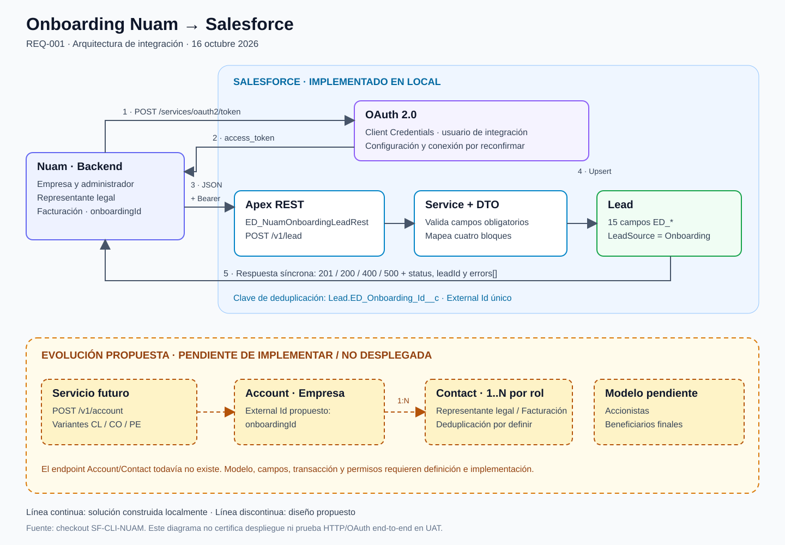
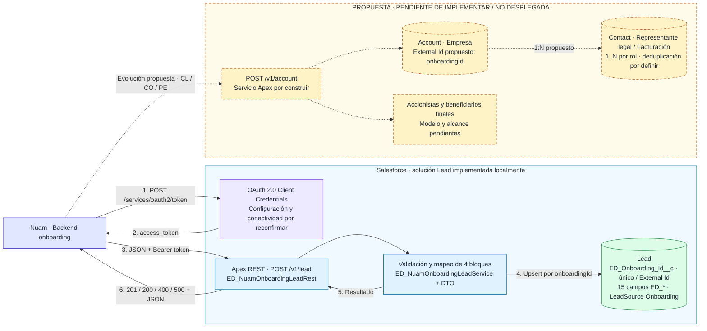

# Integración Onboarding Nuam → Salesforce

Fecha: 2026-10-16. Diagrama derivado del código y de los borradores locales.



## Lectura y alcance

- El panel azul representa componentes implementados en el checkout. No certifica despliegue ni prueba end-to-end en UAT.
- OAuth Client Credentials representa el mecanismo documentado; usuario Run As, permisos y políticas requieren alineación y verificación en la org.
- El panel ámbar representa exclusivamente la propuesta Account + Contact. Su endpoint no existe en la implementación actual.
- No se incluye middleware: no hay uno implementado o documentado en este alcance.
- Los contratos y diagramas no contienen credenciales. La ruta completa implementada es `/services/apexrest/nuam/onboarding/v1/lead`.

## Fuente editable Mermaid

El archivo [diagrama-integracion-onboarding.mmd](diagrama-integracion-onboarding.mmd) contiene la fuente. El SVG es una vista de presentación de la misma arquitectura, con distribución manual tipo herramienta de diagramación.



## Secuencia síncrona implementada

```mermaid
sequenceDiagram
    autonumber
    participant N as Nuam Backend
    participant O as Salesforce OAuth
    participant R as Apex REST
    participant S as Onboarding Service + DTO
    participant L as Lead
    Note over N,L: Implementación local; OAuth y estado UAT por reconfirmar
    N->>O: POST /services/oauth2/token (Client Credentials)
    O-->>N: access_token + instance_url
    N->>R: POST /v1/lead (JSON + Bearer)
    R->>S: Deserializar y validar request
    alt Payload obligatorio incompleto
        S-->>R: status=error + errors[]
        R-->>N: HTTP 400 + JSON
    else Payload válido
        S->>L: Upsert por ED_Onboarding_Id__c
        L-->>S: Resultado DML
        S-->>R: status + leadId
        R-->>N: HTTP 201 created / 200 updated
    end
    Note over R,S: JSON inválido: 400; excepción no controlada: 500
```

## Alternativa de texto

```text
NUAM backend
  |-- OAuth Client Credentials --> Salesforce OAuth
  |<--------- access_token -------|
  |-- POST /v1/lead + Bearer ----> Apex REST
  |                                  |
  |                             Service + DTO
  |                                  |
  |                           upsert por External Id
  |                                  v
  |                                Lead
  |<----- HTTP + JSON (leadId) -------|

PROPUESTA PENDIENTE DE IMPLEMENTAR
NUAM -- /v1/account --> Servicio futuro --> Account --> Contact (1:N)
                           |
                           +--> Accionistas / beneficiarios: por definir
```
